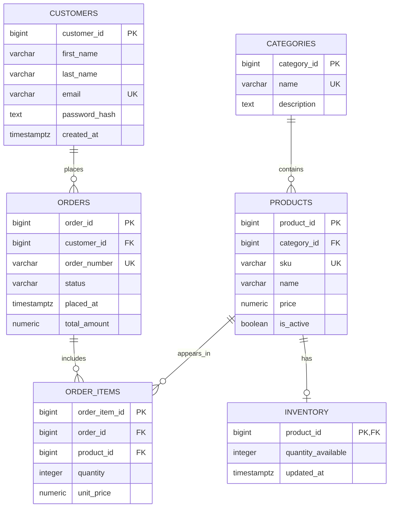

# E-Commerce Database Design & SQL Analytics

   

A hands-on **relational database design and SQL reporting** project for an e-commerce scenario, built with **PostgreSQL 17**. It demonstrates entity modeling, referential integrity, normalization decisions, sample data, reporting queries, indexing, and introductory query-plan analysis.

> **Scope:** This is a database/SQL project, **not** a complete e-commerce website, REST API, payment processor, or production-ready checkout system.

## Table of Contents

- [Goals](#goals)
- [Technology](#technology)
- [Database Model](#database-model)
- [Entity Relationship Diagram](#entity-relationship-diagram)
- [Schema and Data Integrity](#schema-and-data-integrity)
- [Getting Started](#getting-started)
- [Sample Data](#sample-data)
- [SQL Reports](#sql-reports)
- [Indexes and Query Performance](#indexes-and-query-performance)
- [Normalization and Denormalization](#normalization-and-denormalization)
- [Repository Structure](#repository-structure)
- [Current Limitations](#current-limitations)
- [Roadmap](#roadmap)
- [Project Reference](#project-reference)

## Goals

- Model real-world customers, categories, products, stock, orders, and order lines.
- Enforce keys, uniqueness, checks, and foreign-key relationships in PostgreSQL.
- Preserve historical order-line pricing separately from current catalog prices.
- Produce practical daily, monthly, yearly, product-ranking, and customer-value reports.
- Explore PostgreSQL indexes and understand `EXPLAIN (ANALYZE, BUFFERS)` output.
- Document normalization choices and explain when denormalization may be appropriate.

## Technology

| Tool | Purpose |
| --- | --- |
| PostgreSQL 17 | Relational database management system |
| SQL | Schema, integrity constraints, queries and analytics |
| pgAdmin 4 | Database administration and query execution |
| draw.io / diagrams.net | Editable ERD source |
| GitHub | Version control and documentation |

## Database Model

The first version has **six** tables:

| Table | Primary key | Responsibility |
| --- | --- | --- |
| `customers` | `customer_id` | Customer details and email uniqueness |
| `categories` | `category_id` | Product classifications |
| `products` | `product_id` | Catalog, SKU, current price and active flag |
| `inventory` | `product_id` | Available quantity for a product |
| `orders` | `order_id` | Customer orders, status, order number and stored total |
| `order_items` | `order_item_id` | Product quantities and per-order unit-price snapshots |

### Relationships

| Parent → child | Cardinality | Foreign key |
| --- | --- | --- |
| `customers` → `orders` | 1:N | `orders.customer_id` |
| `categories` → `products` | 1:N | `products.category_id` |
| `products` → `inventory` | 1:0..1 as enforced | `inventory.product_id` (also PK) |
| `orders` → `order_items` | 1:N | `order_items.order_id` |
| `products` → `order_items` | 1:N | `order_items.product_id` |

`order_items` resolves the conceptual many-to-many relationship between orders and products. The shared PK/FK limits each product to **at most one** inventory row; creating an inventory row for *every* product is an additional application/transaction rule.

## Entity Relationship Diagram



[Open the editable draw.io ERD](diagrams/ecommerce_erd.drawio). The diagram above is a README visualization of the same logical schema; refer to the schema SQL for definitive constraints.

## Schema and Data Integrity

Core design rules implemented in [`database/01_schema.sql`](database/01_schema.sql):

- `BIGINT GENERATED ALWAYS AS IDENTITY` for independent surrogate keys.
- Primary keys and unique constraints (customer email, category name, product SKU, order number, and the `(order_id, product_id)` combination).
- Foreign keys with restricted deletion of referenced business records.
- `NUMERIC(12,2)` for monetary amounts, not floating-point.
- Checks for nonnegative catalog price and stock, positive item quantity and nonnegative order-line price.
- Allowed order statuses: `PENDING`, `CONFIRMED`, `SHIPPED`, `DELIVERED`, `CANCELLED`.
- `TIMESTAMPTZ` for timestamps.

**Historical pricing:** `order_items.unit_price` captures the price applicable to an order line and need not equal `products.price` after later catalog changes.

**Security:** `password_hash` must contain a properly generated password hash in a real application; the supplied demo seed uses **non-authenticating placeholders**, not usable password credentials.

## Getting Started

### Prerequisites

- PostgreSQL 17 installed and running; access through `psql` or pgAdmin 4.
- Permission to create a database (or an existing empty database you control).

### 1. Clone the repository

```bash
git clone https://github.com/AhmedIsmailGhazy/ecommerce-database-design.git
cd ecommerce-database-design
```

### 2. Create an empty database

Connect to the default `postgres` database and execute:

```sql
CREATE DATABASE ecommerce_db WITH ENCODING = 'UTF8' TEMPLATE = template0;
```

> Run this once, outside a transaction, and only if `ecommerce_db` does not already exist. Use a separate development database if you already have local data you want to keep.

### 3. Apply the SQL files in order

Using `psql` from the project root (replace the username/host as appropriate):

```bash
psql -U postgres -d ecommerce_db -v ON_ERROR_STOP=1 -f database/01_schema.sql
psql -U postgres -d ecommerce_db -v ON_ERROR_STOP=1 -f database/02_sample_data.sql
psql -U postgres -d ecommerce_db -v ON_ERROR_STOP=1 -f database/03_indexes.sql
psql -U postgres -d ecommerce_db -v ON_ERROR_STOP=1 -f database/04_customer_summary_view.sql
```

Alternatively, use **pgAdmin → Databases → ecommerce_db → Query Tool** and open/execute each file in the same order.

**Important:** `01_schema.sql` is intended for a fresh, empty database. `CREATE TABLE IF NOT EXISTS` does **not** migrate existing tables or verify their structure. Do not run these scripts against production data without reviewing them first.

### 4. Verify

```sql
SELECT table_name
FROM information_schema.tables
WHERE table_schema = 'public'
  AND table_type = 'BASE TABLE'
ORDER BY table_name;

SELECT o.order_number,
       o.total_amount AS stored_total,
       COALESCE(SUM(oi.quantity * oi.unit_price), 0) AS calculated_total
FROM public.orders o
LEFT JOIN public.order_items oi ON oi.order_id = o.order_id
GROUP BY o.order_id, o.order_number, o.total_amount
ORDER BY o.order_number;
```

The schema query should include the six model tables. The second query lets you confirm whether each stored order total matches its line items.

## Sample Data

[`database/02_sample_data.sql`](database/02_sample_data.sql) inserts an educational data set with two customers, two categories, three products and inventory records, two orders and three order items. The seed uses `ON CONFLICT DO NOTHING` for selected business keys and updates totals for its demo orders.

| Order | Status | Expected total (SAR assumption) |
| --- | --- | ---: |
| `DEMO-ORD-001` | `PENDING` | 4,440.00 |
| `DEMO-ORD-002` | `PENDING` | 900.00 |

These totals are **order values, not recognized revenue**. The schema does not store a currency code; project examples **assume SAR** and must not be interpreted as supporting multiple currencies.

## SQL Reports

All reports are under [`reports/`](reports/). Open each SQL file in a Query Tool connected to `ecommerce_db`.

| Report | Description |
| --- | --- |
| [01 — Daily sales](reports/01_daily_sales.sql) | Daily order counts and value metrics |
| [02 — Monthly sales](reports/02_monthly_sales.sql) | Monthly order activity and value metrics |
| [03 — Yearly sales](reports/03_yearly_sales.sql) | Annual order activity and value metrics |
| [04 — Monthly top products](reports/04_monthly_top_products.sql) | Quantities and value of most-ordered products; excludes cancelled orders |
| [05 — Customers over SAR 300](reports/05_customers_over_300_sar.sql) | Customers whose non-cancelled order values exceeded the threshold in the past month |

The daily/monthly/yearly reports use **UTC order-placement dates**. In those reports, `recognized_revenue` is defined *for demonstration only* as the value of orders **currently** marked `DELIVERED`. No delivery timestamp is stored, so this is **not** revenue recognized on the date of delivery. Other report metrics may include pending orders; see [`reports/README.md`](reports/README.md) for exact definitions.

### Example: monthly top-ordered products

```sql
SELECT p.sku, p.name AS product_name,
       SUM(oi.quantity) AS total_quantity,
       SUM(oi.quantity * oi.unit_price) AS total_order_value
FROM public.products p
JOIN public.order_items oi ON oi.product_id = p.product_id
JOIN public.orders o ON o.order_id = oi.order_id
WHERE o.placed_at >= DATE_TRUNC('month', CURRENT_TIMESTAMP)
  AND o.placed_at < DATE_TRUNC('month', CURRENT_TIMESTAMP) + INTERVAL '1 month'
  AND o.status <> 'CANCELLED'
GROUP BY p.product_id, p.sku, p.name
ORDER BY total_quantity DESC, total_order_value DESC;
```

This example uses the current session time zone. For the repository's UTC-based reporting convention, use the time-zone boundaries documented in [report 04](reports/04_monthly_top_products.sql).

## Indexes and Query Performance

[`database/03_indexes.sql`](database/03_indexes.sql) adds four supporting B-tree indexes:

| Index | Column | Query use |
| --- | --- | --- |
| `idx_products_category_id` | `products(category_id)` | Category/product lookups |
| `idx_orders_customer_id` | `orders(customer_id)` | Customer order history |
| `idx_orders_placed_at` | `orders(placed_at)` | Date-range filtering |
| `idx_order_items_product_id` | `order_items(product_id)` | Product-oriented joins |

PostgreSQL additionally creates indexes for `PRIMARY KEY` and `UNIQUE` constraints. The unique index on `order_items(order_id, product_id)` also supports predicates on its leading column (`order_id`), so a duplicate single-column index is not introduced in this version.

Inspect the planner's actual strategy with:

```sql
EXPLAIN (ANALYZE, BUFFERS)
SELECT * FROM public.orders WHERE customer_id = 1;
```

On the tiny demo data set, PostgreSQL may reasonably choose a sequential scan even with an available index. In a local exercise, a sequential scan took about **0.019 ms** and a forced index scan about **0.034 ms**. These are **illustrative single-run observations**, not robust benchmarks or evidence of production performance. Larger representative data sets and repeated trials are needed for meaningful comparisons.

## Normalization and Denormalization

The data model illustrates relational normalization by separating customer, category, catalog, order, and order-line facts. `order_items` captures historical price, while `orders.total_amount` is a **derived stored value** that must remain synchronized with order lines.

[`database/04_customer_summary_view.sql`](database/04_customer_summary_view.sql) creates `public.v_customer_order_summary`, computing customers' non-cancelled order count and value without storing duplicate customer aggregates. A regular view does **not** physically materialize query results and therefore is not physical denormalization.

See [Normalization and Denormalization Decisions](docs/02_normalization_and_denormalization.md) for discussion of 1NF/2NF/3NF, functional dependencies, and potential materialized/denormalized reporting strategies.

## Repository Structure

```text
ecommerce-database-design/
├── database/
│   ├── 01_schema.sql
│   ├── 02_sample_data.sql
│   ├── 03_indexes.sql
│   └── 04_customer_summary_view.sql
├── diagrams/
│   └── ecommerce_erd.drawio
├── docs/
│   ├── 01_database_requirements.md
│   └── 02_normalization_and_denormalization.md
├── reports/
│   ├── 01_daily_sales.sql
│   ├── 02_monthly_sales.sql
│   ├── 03_yearly_sales.sql
│   ├── 04_monthly_top_products.sql
│   ├── 05_customers_over_300_sar.sql
│   └── README.md
└── README.md
```

## Current Limitations

- No backend/frontend, authentication service, payment flow, shipping, tax, refund or multi-currency support.
- Checkout, stock reservation and inventory changes are **not implemented** as a reliable end-to-end transactional workflow.
- `orders.total_amount` is updated for demo seed rows, **not automatically enforced on every order-item modification**.
- `inventory.updated_at` has a default on insert but no automatic update trigger.
- Valid order-status values are checked, but allowed state **transitions** are not enforced.
- A product can have zero inventory rows unless product creation explicitly supplies one; an order can exist without order items until the application workflow prevents it.
- No automated database tests or CI pipeline yet; performance measurements use a very small data set.

## Roadmap

- [ ] Add CTE and window-function reporting examples (customer rankings, trends).
- [ ] Add transactional order creation, stock validation, and order-total synchronization.
- [ ] Add automated integrity tests on a clean database.
- [ ] Benchmark with realistic volumes and document query-plan comparisons.
- [ ] Evaluate materialized views only after measuring query workloads.
- [ ] Consider payments, shipping, reviews, promotions, and migration tooling in later versions.

## Project Reference

Inspired by the educational database-design concepts in [Esraa-Khaled/E-Commerce](https://github.com/Esraa-Khaled/E-Commerce). This repository uses a separately evolved schema, reports, and documentation rather than reproducing the reference verbatim.

---

**Maintained by:** [AhmedIsmailGhazy](https://github.com/AhmedIsmailGhazy) · Educational PostgreSQL / SQL portfolio project.
