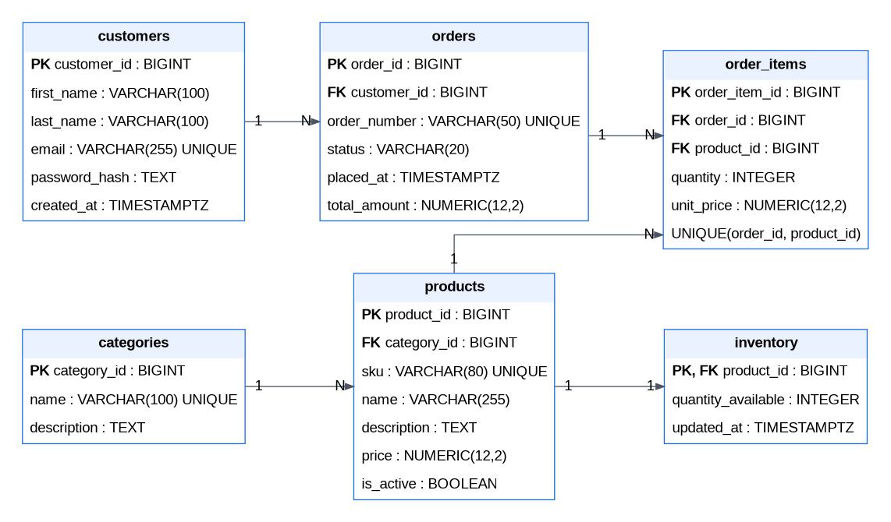

# E-Commerce Database Design & SQL Analytics


A **PostgreSQL database engineering portfolio project** that demonstrates relational modeling, transactional checkout, inventory consistency, concurrency control, idempotent order processing, SQL analytics, and versioned schema migrations.

Designed and implemented using **PostgreSQL 17, SQL, PL/pgSQL, JSONB, and Flyway**, with architecture decisions and executable database tests documented alongside the code.

> **Scope:** This is a database-focused educational implementation—not a complete e-commerce application, REST API, payment platform, or production-ready checkout system.

## At a Glance

| Area | Delivered |
| --- | --- |
| Relational schema | 6 business tables with primary keys, foreign keys, uniqueness, and check constraints |
| Checkout | Single-product, multi-product, and idempotent PL/pgSQL functions |
| Transaction safety | Conditional inventory updates, row locking, transaction-scoped advisory locks |
| Reporting | 9 analytical SQL reports and a reusable customer summary view |
| Schema evolution | 6 ordered Flyway migrations |
| Verification | 5 test scripts covering functional behavior and manual concurrency scenarios |
| Documentation | ERD, database requirements, normalization notes, architecture, and ADRs |

## Contents

- [Architecture](#architecture)
- [Database Model](#database-model)
- [Transactional Checkout](#transactional-checkout)
- [Concurrency and Idempotency](#concurrency-and-idempotency)
- [Getting Started](#getting-started)
- [Flyway Migrations](#flyway-migrations)
- [SQL Reports](#sql-reports)
- [Indexes and Query Plans](#indexes-and-query-plans)
- [Testing and Verified Results](#testing-and-verified-results)
- [Repository Structure](#repository-structure)
- [Design Documentation](#design-documentation)
- [Scope and Limitations](#scope-and-limitations)
- [Author](#author)

## Architecture

The implementation places business-critical data rules in PostgreSQL:

1. **Relational storage:** Customers, catalog, stock, order headers, and order lines.
2. **Database operations:** PL/pgSQL checkout functions running within caller-controlled transactions.
3. **Consistency controls:** Constraints, conditional stock updates, row locks, and order-number-based retry handling.
4. **Analytics:** SQL reports and a non-materialized customer summary view.
5. **Schema management:** Flyway versioned migrations with execution history.

See [System Architecture](docs/03_system_architecture.md) for component responsibilities, checkout flows, and operational boundaries.

## Database Model

The schema contains six business tables:

| Table | Primary key | Responsibility |
| --- | --- | --- |
| `customers` | `customer_id` | Customer details and unique email |
| `categories` | `category_id` | Product classification |
| `products` | `product_id` | SKU, category, catalog price, active state |
| `inventory` | `product_id` | Available stock for a product |
| `orders` | `order_id` | Customer, unique order number, status, stored total |
| `order_items` | `order_item_id` | Products, quantities, historical unit prices |

### Entity Relationship Diagram



[View the SVG](diagrams/ecommerce_erd.svg) · [Edit the draw.io diagram](diagrams/ecommerce_erd.drawio)

### Relationships and Integrity

- `customers` → `orders`: one-to-many.
- `categories` → `products`: one-to-many.
- `products` → `inventory`: one-to-zero-or-one (inventory uses `product_id` as PK and FK).
- `orders` → `order_items`: one-to-many.
- `products` → `order_items`: one-to-many.
- A unique `(order_id, product_id)` constraint prevents repeated product lines within an order.
- `BIGINT GENERATED ALWAYS AS IDENTITY` provides surrogate keys for independent entities.
- `NUMERIC(12,2)` stores prices and monetary totals; check constraints disallow negative prices, stock, and totals.
- Order item quantities must be positive, and order statuses belong to a constrained set.
- Foreign keys protect relationships; they do not, by themselves, guarantee that every product has an inventory row or every order has items.

**Historical price preservation:** `products.price` represents the current catalog price; `order_items.unit_price` records the price captured at checkout. `orders.total_amount` is a stored derived value maintained by the checkout functions, not automatically recalculated after arbitrary direct edits.

## Transactional Checkout

Three database functions implement progressively richer checkout behavior.

| Function | Inputs | Behavior |
| --- | --- | --- |
| [`create_checkout_order`](migrations/V4__create_checkout_function.sql) | Customer, product, quantity, order number | Atomically creates a single-product order |
| [`create_multi_product_checkout`](migrations/V5__create_multi_product_checkout.sql) | Customer, order number, JSONB items | Validates and creates a multi-item order in one transaction |
| [`create_idempotent_checkout`](migrations/V6__create_idempotent_checkout.sql) | Customer, order number, JSONB items | Returns a matching existing order on retry; rejects conflicts |

### Single-product example

Run in a **disposable test database with sample data loaded**:

```sql
BEGIN;

SELECT *
FROM public.create_checkout_order(
    (SELECT customer_id FROM public.customers
     WHERE email = 'demo.ahmed@example.invalid'),
    (SELECT product_id FROM public.products
     WHERE sku = 'DEMO-LAPTOP-001'),
    1,
    'README-SINGLE-001'
);

ROLLBACK;
```

### Multi-product example

```sql
BEGIN;

SELECT *
FROM public.create_multi_product_checkout(
    (SELECT customer_id FROM public.customers
     WHERE email = 'demo.ahmed@example.invalid'),
    'README-MULTI-001',
    jsonb_build_array(
        jsonb_build_object(
            'product_id', (SELECT product_id FROM public.products WHERE sku = 'DEMO-LAPTOP-001'),
            'quantity', 1
        ),
        jsonb_build_object(
            'product_id', (SELECT product_id FROM public.products WHERE sku = 'DEMO-MOUSE-001'),
            'quantity', 2
        )
    )
);

ROLLBACK;
```

Both demonstrations intentionally roll back their changes. Checkout functions do **not** issue `COMMIT` or `ROLLBACK`; the caller controls the transaction. Exceptions must be handled by the caller.

## Concurrency and Idempotency

### Inventory consistency

Checkout uses a **conditional atomic `UPDATE`** and checks whether a row was updated. If stock is insufficient, the function raises an exception instead of creating a successful sale.

```sql
UPDATE public.inventory
SET quantity_available = quantity_available - 1,
    updated_at = CURRENT_TIMESTAMP
WHERE product_id = 1
  AND quantity_available >= 1;
```

Product row locks protect the captured price and active state. Multi-product checkout processes product IDs in ascending order to reduce the likelihood of deadlocks, though deadlocks remain possible in more complex workloads.

### Retry-safe order creation

`create_idempotent_checkout` uses a unique `orders.order_number` constraint and a transaction-scoped advisory lock derived from the order number. A retry with the **same customer, products, and quantities** returns the existing order without deducting inventory a second time. A conflicting retry raises an exception.

This is **database-level order-number idempotency**, not a generic HTTP idempotency-key service. Advisory-lock hash collisions can theoretically cause unrelated order numbers to wait on the same lock.

## Getting Started

### Prerequisites

- PostgreSQL 17 and a PostgreSQL login with sufficient schema privileges.
- `psql` or pgAdmin 4.
- Flyway CLI for the recommended versioned schema installation.
- Git, or a ZIP download of the repository.

### 1. Get the repository

```bash
git clone https://github.com/AhmedIsmailGhazy/ecommerce-database-design.git
cd ecommerce-database-design
```

### 2. Create a dedicated empty database

In pgAdmin, connect to an existing maintenance database (such as `postgres`), then run:

```sql
CREATE DATABASE ecommerce_flyway_test
WITH ENCODING = 'UTF8' TEMPLATE = template0;
```

Create it only once. **Never replace or reinitialize a database containing data you need to preserve.**

### 3. Apply versioned migrations

On Windows PowerShell, open a terminal **from the repository root**, where the `migrations` folder is located. The commands below assume `flyway` is installed and available in your `PATH`. Otherwise, replace `flyway` with the full path to `flyway.cmd`.

```powershell
$env:FLYWAY_URL = 'jdbc:postgresql://localhost:5432/ecommerce_flyway_test'
$env:FLYWAY_USER = 'postgres'
$env:FLYWAY_LOCATIONS = 'filesystem:./migrations'

$securePassword = Read-Host 'PostgreSQL password' -AsSecureString

try {
    $credential = [System.Net.NetworkCredential]::new('', $securePassword)
    $env:FLYWAY_PASSWORD = $credential.Password

    flyway info
    if ($LASTEXITCODE -ne 0) { throw 'Flyway info failed' }

    flyway migrate
    if ($LASTEXITCODE -ne 0) { throw 'Flyway migrate failed' }

    flyway info
    if ($LASTEXITCODE -ne 0) { throw 'Final Flyway info failed' }
}
finally {
    Remove-Item Env:FLYWAY_PASSWORD, Env:FLYWAY_USER, Env:FLYWAY_URL, Env:FLYWAY_LOCATIONS -ErrorAction SilentlyContinue
    $credential = $null
    $securePassword = $null
}
```

Use **a different target database** from any existing hand-built development database. Do not run the manual schema initialization and Flyway initialization against the same database.

### 4. Confirm the installed version

Open pgAdmin Query Tool against `ecommerce_flyway_test`:

```sql
SELECT installed_rank, version, description, success, installed_on
FROM public.flyway_schema_history
ORDER BY installed_rank;
```

A successful fresh installation should report six versioned migrations, V1–V6, with `success = true`.

### 5. Load optional sample data

For the report and checkout examples, apply [`database/02_sample_data.sql`](database/02_sample_data.sql) to a **test** database *after* schema initialization. Sample data is intentionally separate from structural Flyway migrations.

### Alternative: standalone SQL installation

The [`database/`](database/) folder retains original educational scripts. In a **separate empty database not managed by Flyway**, execute them in filename order from `01_schema.sql` through `07_idempotent_checkout.sql` (including `02_sample_data.sql`). Do not apply both installation paths to one database.

## Flyway Migrations

| Version | Migration | Creates |
| --- | --- | --- |
| V1 | [`V1__create_schema.sql`](migrations/V1__create_schema.sql) | Tables, keys, foreign keys, and checks |
| V2 | [`V2__create_indexes.sql`](migrations/V2__create_indexes.sql) | Supporting indexes |
| V3 | [`V3__create_customer_summary_view.sql`](migrations/V3__create_customer_summary_view.sql) | Customer summary view |
| V4 | [`V4__create_checkout_function.sql`](migrations/V4__create_checkout_function.sql) | Single-product checkout |
| V5 | [`V5__create_multi_product_checkout.sql`](migrations/V5__create_multi_product_checkout.sql) | Multi-product checkout |
| V6 | [`V6__create_idempotent_checkout.sql`](migrations/V6__create_idempotent_checkout.sql) | Idempotent checkout |

**Observed migration verification — November 7, 2026:** Flyway OSS 13.12.1 connected to PostgreSQL 17.11 on `ecommerce_flyway_test`. All six migrations were applied successfully, and `public.flyway_schema_history` showed six `success = true` records (schema version V6). This confirms deployment success, not a new functional test run on the migrated database.

Previously applied migration files should remain immutable; subsequent schema changes require new versioned migrations. Keep credentials out of Git.

## SQL Reports

Nine reporting queries are available in [`reports/`](reports/):

| Report | Purpose |
| --- | --- |
| [01 — Daily sales](reports/01_daily_sales.sql) | Daily order and value metrics |
| [02 — Monthly sales](reports/02_monthly_sales.sql) | Monthly performance |
| [03 — Yearly sales](reports/03_yearly_sales.sql) | Annual performance |
| [04 — Monthly top products](reports/04_monthly_top_products.sql) | Most ordered products during a month |
| [05 — Customers over SAR 300](reports/05_customers_over_300_sar.sql) | Spending threshold within the past month |
| [06 — Customer ranking](reports/06_customer_ranking.sql) | Rank customers by order activity/value |
| [07 — Monthly sales growth](reports/07_monthly_sales_growth.sql) | Month-over-month change |
| [08 — Top products by category](reports/08_top_products_by_category.sql) | Rankings within product categories |
| [09 — Cumulative sales](reports/09_cumulative_sales.sql) | Running sales totals |

The reporting layer demonstrates joins, aggregation, CTEs, date boundaries, window functions, and ranking. See [report definitions and caveats](reports/README.md).

**Metric limitations:** Examples assume SAR but store no currency code. Daily/monthly/yearly report periods are based on UTC order-placement dates. An illustrative `recognized_revenue` measure uses orders *currently marked* `DELIVERED`; it is not a financial accounting implementation and does not represent revenue recognized on delivery dates.

## Indexes and Query Plans

Four additional B-tree indexes support common joins and filters:

| Index | Column |
| --- | --- |
| `idx_products_category_id` | `products(category_id)` |
| `idx_orders_customer_id` | `orders(customer_id)` |
| `idx_orders_placed_at` | `orders(placed_at)` |
| `idx_order_items_product_id` | `order_items(product_id)` |

Primary-key and unique constraints create indexes as well. The composite unique constraint on `order_items(order_id, product_id)` also supports queries filtering by leading column `order_id`.

Example plan inspection:

```sql
EXPLAIN (ANALYZE, BUFFERS)
SELECT * FROM public.orders WHERE customer_id = 1;
```

On very small demonstration datasets, sequential scans can be cheaper than index scans. The repository does **not** claim production-scale performance measurements.

## Testing and Verified Results

| Script | Scope |
| --- | --- |
| [`01_checkout_tests.sql`](tests/01_checkout_tests.sql) | Single-product checkout, validation, rollback, stock handling |
| [`02_concurrency_tests.sql`](tests/02_concurrency_tests.sql) | Manually coordinated, two-session inventory concurrency |
| [`03_multi_product_checkout_tests.sql`](tests/03_multi_product_checkout_tests.sql) | Multi-product checkout cases |
| [`04_idempotent_checkout_tests.sql`](tests/04_idempotent_checkout_tests.sql) | Repeated requests and conflicts |
| [`05_concurrent_idempotency_tests.sql`](tests/05_concurrent_idempotency_tests.sql) | Manually coordinated concurrent retry behavior |

### Previously observed local results

| Area | Result |
| --- | --- |
| Single-product checkout tests | **5/5 passed** |
| Multi-product checkout tests | **3/3 passed** |
| Idempotent checkout tests | **4/4 passed** |
| Manual inventory concurrency | Passed the documented scenario |
| Manual concurrent idempotency | Passed the documented scenarios |
| Flyway installation in test database | **6/6 migrations applied successfully** |

These are observed **local development results**. The Flyway deployment was verified separately; the functional tests were **not reported as rerun** against `ecommerce_flyway_test`.

**Safe execution:** Run tests only on disposable databases with the required fixtures. Read each script first. Concurrency scripts require separate database sessions and should not be executed as a single sequential automated script. Some fixtures modify inventory and test records.

## Repository Structure

```text
ecommerce-database-design/
├── database/
│   ├── 01_schema.sql
│   ├── 02_sample_data.sql
│   ├── 03_indexes.sql
│   ├── 04_customer_summary_view.sql
│   ├── 05_checkout_function.sql
│   ├── 06_multi_product_checkout.sql
│   └── 07_idempotent_checkout.sql
├── migrations/
│   ├── V1__create_schema.sql
│   ├── V2__create_indexes.sql
│   ├── V3__create_customer_summary_view.sql
│   ├── V4__create_checkout_function.sql
│   ├── V5__create_multi_product_checkout.sql
│   └── V6__create_idempotent_checkout.sql
├── reports/
│   ├── 01_daily_sales.sql
│   ├── 02_monthly_sales.sql
│   ├── 03_yearly_sales.sql
│   ├── 04_monthly_top_products.sql
│   ├── 05_customers_over_300_sar.sql
│   ├── 06_customer_ranking.sql
│   ├── 07_monthly_sales_growth.sql
│   ├── 08_top_products_by_category.sql
│   ├── 09_cumulative_sales.sql
│   └── README.md
├── tests/
│   ├── 01_checkout_tests.sql
│   ├── 02_concurrency_tests.sql
│   ├── 03_multi_product_checkout_tests.sql
│   ├── 04_idempotent_checkout_tests.sql
│   └── 05_concurrent_idempotency_tests.sql
├── diagrams/
│   ├── ecommerce_erd.drawio
│   ├── ecommerce_erd.png
│   └── ecommerce_erd.svg
├── docs/
│   ├── 01_database_requirements.md
│   ├── 02_normalization_and_denormalization.md
│   ├── 03_system_architecture.md
│   └── 04_architecture_decisions.md
└── README.md
```

## Design Documentation

- [Database Requirements](docs/01_database_requirements.md): data and functional scope.
- [Normalization and Denormalization](docs/02_normalization_and_denormalization.md): modeling rationale and trade-offs.
- [System Architecture](docs/03_system_architecture.md): components, transaction flows, and boundaries.
- [Architecture Decision Records](docs/04_architecture_decisions.md): PostgreSQL, relational modeling, transaction safety, idempotency, Flyway, and historical pricing decisions.
- [ERD source](diagrams/ecommerce_erd.drawio): editable visual database model.

## Scope and Limitations

The project's **defined database portfolio scope is complete**, but the implementation is not a full commerce platform. Specifically:

- No frontend, REST API, payment processor, shipping or refund workflow.
- No complete authentication/authorization system; sample password hashes are non-authenticating placeholders.
- No complete order-state transition enforcement, taxation, or multi-currency accounting.
- Direct writes outside checkout functions can bypass stored-total and stock invariants.
- `inventory.updated_at` is updated by checkout logic but has no general automatic update trigger.
- The schema permits products without inventory rows and order headers without order items.
- Manual concurrency tests are scenario-based; there is no claimed exhaustive concurrency proof.
- No claimed production-scale benchmarks, automated CI deployment, or production backup/recovery program.

These are intentional scope boundaries, not claims of features implemented elsewhere.

## Author

**Ahmed Ismail Ghazy**  
GitHub: [AhmedIsmailGhazy](https://github.com/AhmedIsmailGhazy)  
Repository: [ecommerce-database-design](https://github.com/AhmedIsmailGhazy/ecommerce-database-design)

---

*PostgreSQL-focused database engineering: relational integrity, transactional consistency, practical SQL analytics, and maintainable schema evolution.*
